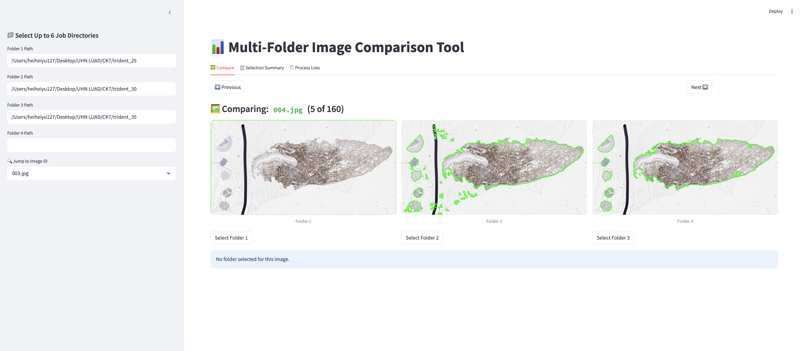

# WSI-Pipeline

## Setup (HPC4Health)

```
git clone git@github.com:haydenych/WSI-Pipeline.git

module load python3/3.10.9
cd WSI-Pipeline
git submodule update --init --recursive
python3.10 -m venv .venv && source .venv/bin/activate
pip3 install --upgrade pip
pip3 install -r requirements_h4h.txt
```

## Setup (Compute Canada)

Currently, only Cedar and Narval are supported.

If you are new, please clone this repository into scratch instead of projects. There is a
1000k file limit in projects that is shared across the group. Installing virtual environment
will take up ~60k files.

```
git clone git@github.com:haydenych/WSI-Pipeline.git

module load StdEnv/2023
module load python/3.10.13 openslide/4.0.0 opencv/4.10.0 arrow/18.1.0
cd WSI-Pipeline
git submodule update --init --recursive
python3.10 -m venv .venv && source .venv/bin/activate
pip3 install --upgrade pip
pip3 install -r requirements_cc.txt
```

If you have some experience with compute canada and would like to 
seperate the virtual environment from the repository. 
Replace the lines for the virtual environment with this.

```
ENV="<YOUR PATH TO ENV>" 
python3.10 -m venv $ENV/.venv && source $ENV/.venv/bin/activate
```

Otherwise, You can also move this setup process into the slurm script.

## Example (For Beginners)

Run this if you are on hpc4health.

```
sbatch example/run_hpc4health.sh
```

Run this if you are on Cedar or Narval.

```
sbatch example/run_computecanada.sh
```

Your goal is to read and understand the folders

-   `contours`
-   `20x_256px_0px_overlap/visualization`
-   `20x_256px_0px_overlap/patches` (Open the .h5 files with Python)
-   `20x_256px_0px_overlap/features_uni_v2` (Open the .h5 files with Python)

## How to use the tool?

### Step 1: Preparing the config file

-   Create a copy of [configs/config_template.yaml](configs/config_template.yaml).
-   Change `io.wsi_dir` to your slide images directory. Make sure this path links directly to the slide images but not sub-folders containing the images.
-   Change `io.job_dir` to your output location.
-   For first time users, you may also want to change `patching.magnification` and `patching.patch_size`, while leaving the rest untouched.
-   Refer to the [config instruction manual](configs/config_instructions.md) for detailed usage of each configuration.

### Step 2: Preparing the run script

-   Create a copy of [scripts/\*\*/run_template.sh](scripts/hpc4health/run_template.sh).
-   Change variables marked with **TODO**.
-   For **TODOs** in sbatch, you can simply delete the line if you do not want them. You can also replace the whole slurm section if you wish. Please refer to the [sbatch guide](https://slurm.schedmd.com/sbatch.html) for detailed usage.
-   If you simply want to extract features, use `TASK="all"`. If you are cautious and want some extra quality control, use `TASK="seg"` to check the segmentation contours. Then proceed with patching `TASK="patch"` and feature extraction `TASK="feat"`.

-   **Reminder**: Do not add any space bars between vairiable assignments in a bash script. i.e. `TASK = "all"` will cause you an [error](https://stackoverflow.com/a/41748518) :)

### Step 3: Run the bash script

Reminder: Run `sbatch` at the `WSI-Pipeline` directory. Trying to `cd` into `scripts` and run `sbatch` inside will break due to relative paths.

```
sbatch scripts/hpc4health/run.sh
```

## Streamlit (Comparing multiple job directories)

For first time users, you can skip this session. This tool allows you to compare across multiple job directories and select the desired segmentation threshold `seg_conf_thresh` for the best outcome.

After running the above script, if you find segmentation performance not up to standard and would like to have per-slide segmentation threshold, this tool can be helpful.

To start, run the script multiple time but each with different `seg_conf_thresh`. You will want to use `TASK="seg"` since you are only focusing on segmentation.
In streamlit, input your job directories and manually select the ones you want to keep.
Finally, you can export your selections to csv at the **Process Lists** tab. These csv files will be good for the config option `custom_list_of_wsis`.

```
streamlit run wsi-pipeline/streamlit.py
```



### Port Forwarding on slurm clusters

Running streamlit on slurm clusters requires SSH tunneling to work with. As an example on HPC4Health:

```
# On h4huhnlogin node
salloc -t 1:00:00 -c 2 --mem 4G

# On h4h allocated node
streamlit run wsi-pipeline/streamlit.py --server.port 8501

# On your local computer
ssh -L 8501:localhost:8501 -J t******uhn@h4huhnlogin1.uhnresearch.ca t******uhn@node***

# Access the webpage with a browser on your local computer
localhost:8501
```

For more details, please read the [docs](https://docs.alliancecan.ca/wiki/SSH_tunnelling) from compute canada.

## Common Errors / FAQ

Q: I cannot git clone this repository.

A: Since this is a private repository, you'll have to set up a [ssh key](https://docs.github.com/en/authentication/connecting-to-github-with-ssh/generating-a-new-ssh-key-and-adding-it-to-the-ssh-agent) to clone this repo.

Q: I run something wrong and have to cancel using `scancel` / I want to pause using `scancel` and rerun the script later.

A: When the pipeline runs, it will create `.lock` files to indicate that the slide is being processed, allowing for multiprocessing, you may have to delete these files as well. The safest way is to remove any related files for an incompletely processed slide to avoid the pipeline from skipping it when you rerun the script.
